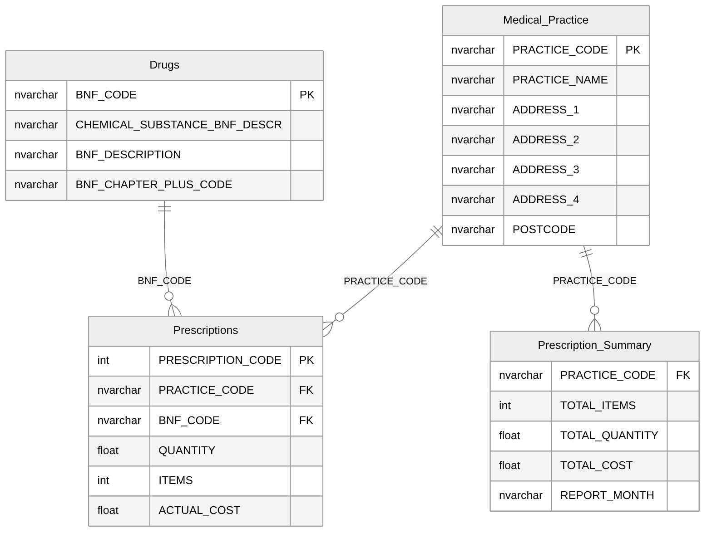

# NHS Prescriptions Analysis: SQL for Healthcare Data

An analysis of real NHS prescribing data for GP practices in Bolton, using Microsoft SQL Server. The data is loaded into a relational database with primary and foreign keys, then queried to answer questions about what is prescribed, by whom, in what quantities and at what cost. Everything is in one script, [nhs_prescriptions_analysis.sql](nhs_prescriptions_analysis.sql).

---

## Scenario

A pharmaceutical company wants to understand prescribing patterns in Bolton: which medicines are prescribed most, which practices prescribe them, how much is dispensed, and what it costs. The source is an extract of the NHS English Prescribing Data, the monthly public dataset of every prescription issued in England, covering 60 GP practices in Bolton.

The data arrives as four CSV files:

| Table | What it holds |
|---|---|
| Medical_Practice | The 60 practices, with name and address. Each practice has a unique practice code. |
| Drugs | Every drug that can be prescribed, with its chemical substance, product description and BNF chapter (the British National Formulary category, for example "05: Infections"). |
| Prescriptions | One row per prescription, linked to a practice and a drug, with the pack size, number of packs and actual cost. |
| Prescription Summary | Monthly totals of items, quantity and cost for each practice, used for reporting. |

## The business problem

The company needed answers to questions like:

- Which drugs come as tablets or capsules?
- How many units are dispensed on each prescription?
- What is the most prescribed chemical substance each month?
- How do prescribing volume and cost differ across therapeutic areas?
- Which practices issue very expensive single prescriptions?
- Which practices specialise in particular kinds of prescribing?
- Which drugs are dispensed in the largest volumes, and so are the best candidates for bulk purchasing?
- Which prescriptions have unusually high costs that might be errors?
- How is spending changing from month to month?

## Contents of the script

1. Database creation
2. Tables, with the original CSV column names
3. Loading the four CSV files
4. Primary keys, foreign keys and indexes
5. Analysis queries
6. Further business questions

## How the database is built

The four CSV files are loaded into tables that keep the original column names. Primary keys are added after loading, which makes the bulk load faster: practice code for practices, BNF code for drugs and prescription code for prescriptions. Foreign keys then make sure every prescription points to a real practice and a real drug, and every monthly summary row belongs to a real practice. Prescriptions is the central table, with practices and drugs as reference tables and the monthly summary alongside for reporting.

## What the analysis found

### Volume and cost by therapeutic area

Grouping prescriptions by BNF chapter shows where volume and cost are concentrated. Some of the larger chapters:

| BNF chapter | Prescriptions | Average cost (£) | Highest single cost (£) |
|---|---|---|---|
| 04: Central Nervous System | 28,866 | 28.40 | 2,765.62 |
| 02: Cardiovascular System | 19,186 | 36.00 | 11,094.75 |
| 06: Endocrine System | 12,462 | 61.17 | 3,490.70 |
| 01: Gastro-Intestinal System | 8,777 | 35.13 | 2,777.69 |
| 09: Nutrition and Blood | 7,944 | 41.82 | 4,250.44 |
| 03: Respiratory System | 7,057 | 75.87 | 4,161.81 |
| 14: Immunological Products and Vaccines | 126 | 1,049.56 | 21,570.92 |

Central nervous system and cardiovascular medicines dominate by volume. Vaccines are rare but by far the most expensive per prescription, because a single prescription often covers a whole flu vaccination programme.

### Very expensive prescriptions

Nine practices issued at least one prescription costing more than £4,000. The three largest were vaccine orders: £21,570.92 and £11,031.59 for flu vaccine at Unsworth Group Practice and Bromley Meadows Surgery, and £8,659.60 at Kildonan House. Four more were bulk prescriptions of Apixaban 5mg tablets, a blood thinner, at between £4,377.65 and £7,313.58.

### Spending over the year

Across the twelve months, Bolton practices spent about £4.54 million, an average of £378,700 a month. Spending was fairly steady, with two exceptions:

- **April** was the highest month at £421,248.51, up 19.6% on March.
- **March** was the lowest at £352,082.92, down 8.7% on February.

### Further questions answered

- **Practice specialisation.** Conditional counting ranks practices by the share of their prescribing that is for the central nervous system, which points to practices with a focus on mental health, neurology or chronic pain. Practices with 100 or fewer prescriptions are left out so small samples don't distort the ranking.
- **Bulk purchasing.** The top 20 drugs by units dispensed, limited to drugs prescribed by at least five different practices, show the widely used medicines where a better unit price would save the most.
- **Unusual costs.** Each prescription's cost is compared with the average for its BNF chapter, and anything more than three standard deviations above it (a z-score above 3) is flagged as a possible data entry error or exceptional case.
- **Month-on-month change.** Each month is lined up with the month before, showing the change in pounds and as a percentage.

### Most prescribed substance per month

The Prescriptions table has no month column. Only the practice-level summary is broken down by month. Joining the two on practice alone would repeat every prescription once for every month that practice reports, which inflates the counts. Instead, each practice's monthly total is shared out across chemical substances in proportion to that practice's prescribing mix, and the substances are then ranked within each month. This gives an honest estimate of the leading substance per month from the data that is available.

## SQL techniques used

| Technique | Where it is used |
|---|---|
| Primary and foreign keys | Linking prescriptions to practices and drugs, and summaries to practices |
| Bulk loading | Importing the four CSV files |
| Pattern matching | Finding tablets and capsules |
| Aggregation with GROUP BY and HAVING | Chapter statistics, practice thresholds, bulk purchasing |
| Subqueries and EXISTS | Most expensive prescription per practice, drugs used by five or more practices |
| Common table expressions | Monthly substance ranking, month-on-month comparison |
| Window functions | Ranking substances within each month, shares within each practice |
| Self join | Comparing each month with the previous one |
| Statistical functions | Standard deviation and z-scores for outlier detection |
| Conditional aggregation | Share of central nervous system prescribing per practice |

## How to run

1. Save the four CSV files (Medical_Practice.csv, Drugs.csv, Prescriptions.csv and Prescriptions Summary.csv) in one folder.
2. Open the script in SQL Server Management Studio (SQL Server 2017 or later) and change the folder path in the loading section to match.
3. Run the whole script. It creates the database, loads the data, adds the keys and runs every query.

## Data source

NHS English Prescribing Data, published monthly by the NHS Business Services Authority. Contains public sector information licensed under the Open Government Licence v3.0.
